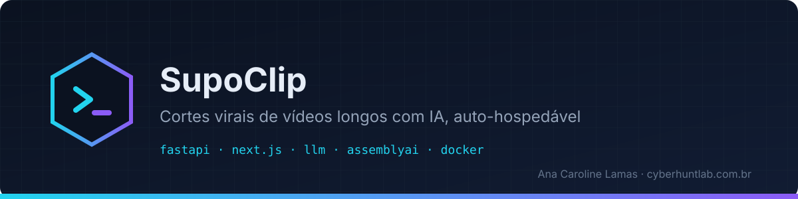

<p align="center"></p>

# SupoClip — cortes virais de vídeos longos com IA (cópia auto-hospedável)

Cópia do projeto de código aberto **[SupoClip](https://github.com/FujiwaraChoki/supoclip)**, uma ferramenta que transforma **vídeos longos** (podcasts, palestras, VODs) em **cortes verticais 9:16** prontos para TikTok, Reels e Shorts. Com IA, ela encontra os trechos com mais potencial, dá uma nota de viralidade a cada um e renderiza os clipes com enquadramento no rosto, legendas sincronizadas por palavra, título de abertura e B-roll opcional. É uma alternativa auto-hospedável e sem marca d'água a serviços como o OpusClip.

Documentação original em inglês: [README-en.md](README-en.md) e pasta [docs/](docs/README.md).

## Recursos

- **Fontes de vídeo**: YouTube, Twitch e Kick (VODs e clipes) ou upload de arquivo próprio.
- **Seleção de cortes por IA**: um LLM (Gemini, GPT, Claude ou Ollama local) escolhe de 3 a 7 trechos a partir da transcrição.
- **Nota de viralidade** por clipe: gancho, engajamento, valor e compartilhamento.
- **Recorte vertical inteligente**: detecção de rosto mantém quem fala centralizado no quadro 9:16.
- **Legendas sincronizadas por palavra** (AssemblyAI ou Whisper), com fontes e modelos animados.
- **Título de abertura** gerado por IA e **B-roll** opcional do Pexels com transições.
- **Editor embutido**: cortar, dividir e juntar clipes e exportar com predefinições por plataforma.
- **Publicação direta** e agendamento no YouTube, TikTok e Instagram, com métricas que realimentam a seleção.
- **Progresso em tempo real**, API REST com chaves e servidor **MCP** para clientes como Claude e Cursor.

## Instalação

Requisitos: **Docker** e Docker Compose, uma chave da **AssemblyAI** (transcrição) e uma chave de LLM (Google, OpenAI, Anthropic) ou um Ollama local.

```bash
git clone https://github.com/ticarollamas-arch/Opusclips-clone.git
cd Opusclips-clone
```

Crie um `.env` na raiz:

```env
ASSEMBLY_AI_API_KEY=sua_chave_assemblyai
LLM=google-gla:gemini-3-flash-preview
GOOGLE_API_KEY=sua_chave_google
```

## Como usar

```bash
docker-compose up -d
docker-compose logs -f        # acompanhe a primeira inicialização
```

- Interface: `http://localhost:3107` (crie uma conta e envie um vídeo).
- API: `http://localhost:8000`, com documentação interativa em `/docs`.
- Testes: `make test` (pytest, Vitest e Playwright).

Guias detalhados: [instalação](docs/setup.md), [configuração](docs/configuration.md), [arquitetura](docs/architecture.md), [API](docs/api-reference.md), [desenvolvimento](docs/development.md) e [solução de problemas](docs/troubleshooting.md).

## Tecnologias

Python · FastAPI · ARQ (fila de tarefas) · uv · Next.js 15 · TypeScript · Tailwind CSS · shadcn/ui · PostgreSQL · Redis · FFmpeg · AssemblyAI · Whisper · Pexels API · Docker Compose · MCP

## Créditos

Projeto original: [SupoClip](https://github.com/FujiwaraChoki/supoclip), de FujiwaraChoki e colaboradores. Esta cópia mantém o código e o aviso de licença originais.

## Licença

**GNU AGPL-3.0**, herdada do projeto original. Veja [LICENSE](LICENSE). Se você modificar e disponibilizar o software como serviço em rede, a AGPL exige que o código-fonte das modificações também seja disponibilizado.
